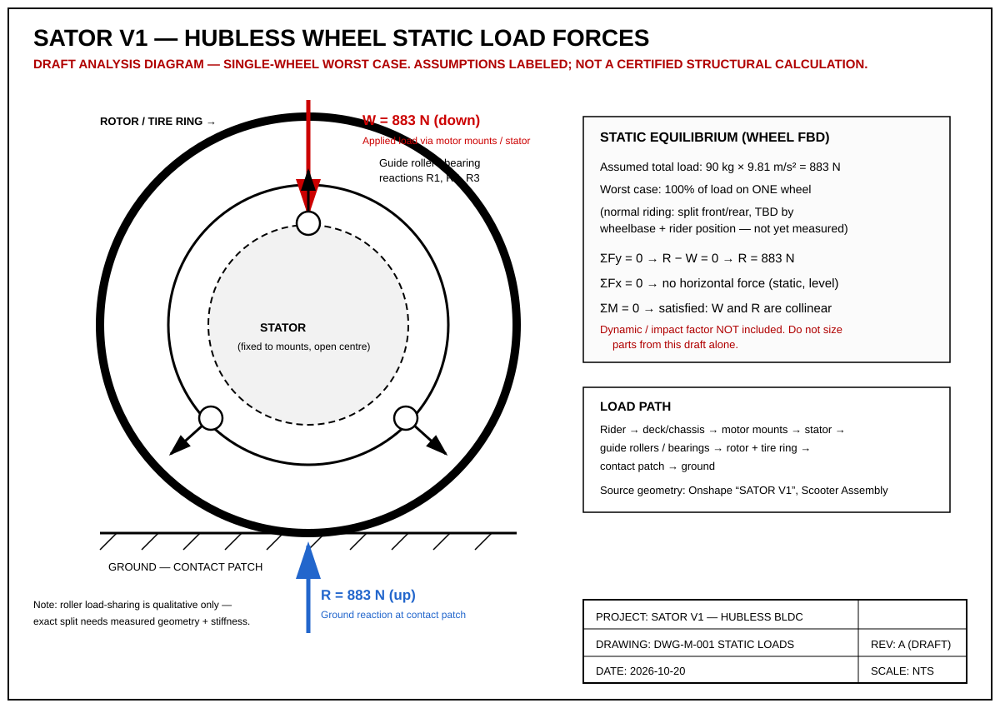

# SATOR V1 — Hubless BLDC Electric Scooter

> **Status: DRAFT SHOWCASE — assembled 2026-10-20 from the Onshape inventory. Specs marked ASSUMED / TBD are not yet verified.**

A stand-up electric scooter built around **two hubless BLDC wheel motors** (front and rear), designed in Onshape by Zackary Aebersold, Mechanical Engineering student at Sacramento City College.



## Overview

The SATOR V1 replaces a conventional hub motor with a hubless (rim-drive) layout: the stator is fixed to the chassis through side motor mounts, the rotor is integrated into the wheel/tire ring, and the open-centre wheel is located by guide rollers/bearings. The result is a wheel with a large open bore, driven at its rim.

- **CAD source of truth:** Onshape document "SATOR V1" (Scooter Assembly)
- **This repo:** public engineering showcase — exports, drawings, BOM, and documentation

## Design / Assembly Structure

| Group | Contents |
|---|---|
| Scooter Assembly (top) | Chassis/deck, stem + steering, shock fork, 2× Motor Assembly |
| Motor Parts | Motor Assembly, Stator, Rotor, RotorMagnetInsert, Rotor plate, Tire |
| Body & Motor Mounts | Base Plate, Stem, Chassis, Foot Rest V3, front/rear motor mounts |
| Purchased / modelled parts | 5 mm ball bearings, 6" × 1/8" × 5/16" magnets, copper coil (winding) |

## Drawings

| Drawing | File | Status |
|---|---|---|
| DWG-E-001 Wiring Diagram (dual motor) | [drawings/wiring-diagram.svg](drawings/wiring-diagram.svg) | Proposed — not as-built |
| DWG-E-002 System Block Diagram | [drawings/system-block-diagram.svg](drawings/system-block-diagram.svg) | Proposed — not as-built |
| DWG-M-001 Static Load Forces (single-wheel worst case, 883 N) | [drawings/static-load-forces.svg](drawings/static-load-forces.svg) | Draft analysis |

## Documentation

| Doc | What's in it |
|---|---|
| [docs/specifications.md](docs/specifications.md) | Spec table — VERIFIED values vs ASSUMED/TBD, kept separate |
| [docs/design-notes.md](docs/design-notes.md) | Design concept, verified Motor Assembly + Copy 1 inventories |
| [docs/calculations.md](docs/calculations.md) | Wheel geometry, speed-vs-RPM table, static load summary |
| [docs/assembly-guide.md](docs/assembly-guide.md) | Assembly sequence (draft, from CAD structure) |
| [docs/testing-plan.md](docs/testing-plan.md) | Planned bench / structural / vehicle test programme |
| [docs/safety.md](docs/safety.md) | Battery, electrical, structural, and shop safety notes |
| [docs/roadmap.md](docs/roadmap.md) | Project status, open decisions, CAD cleanup checklist |
| [docs/known-issues.md](docs/known-issues.md) | Known Onshape defects (Revolute 1, Rotor Extrude 4, …) |
| [docs/electrical-pinout.md](docs/electrical-pinout.md) | Proposed connector pinouts + wire schedule for DWG-E-001 |
| [docs/cost-estimate.md](docs/cost-estimate.md) | Build budget estimate (all values labelled ESTIMATE) |
| [docs/decisions/](docs/decisions/) | Decision records: authoritative assembly, bearings, electrical parts, pole/slot question |
| [bom/sourced-parts.csv](bom/sourced-parts.csv) | Purchased/COTS parts list (companion to the CAD BOM) |
| [tests/test-log-template.md](tests/test-log-template.md) | Test log with the B/S/V test IDs from the testing plan |
| [CHANGELOG.md](CHANGELOG.md) | Repo change history |
| [CONTRIBUTING.md](CONTRIBUTING.md) | How to help — and the rule: never present an assumption as a measurement |

## Repo Contents

```
/cad        → STEP exports from Onshape (export checklist in cad/README.md)
/drawings   → engineering drawings (SVG, PDF on release)
/images     → renders and build photos (wishlist in images/README.md)
/docs       → specifications, design notes, calculations, guides
/bom        → bill of materials (verified against Onshape, 2026-10-20/21)
```

## Known Issues (from Onshape, 2026-10-20)

- Mate **Revolute 1** in Scooter Assembly shows an error (missing/failed reference)
- Most parts in the top assembly still carry generic names (Part 1 / Part 2)
- Onshape BOM part numbers/descriptions are blank — see `bom/bom-draft.csv`
- Foot Rest V1/V2 and Motor Mount V1 tabs are superseded iterations

## Lessons / Next Steps

- Fix Revolute 1 mate and name all instances in Onshape
- Export STEP of Scooter Assembly + Motor Assembly, add renders/exploded view
- Confirm electrical parts (battery, ESCs) and replace ASSUMED values in DWG-E-001
- Measure rider weight distribution front/rear and update DWG-M-001
